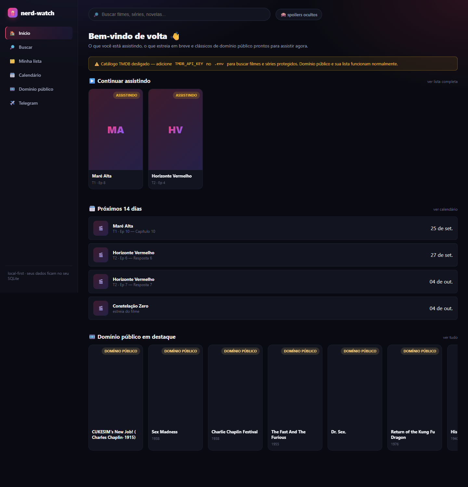
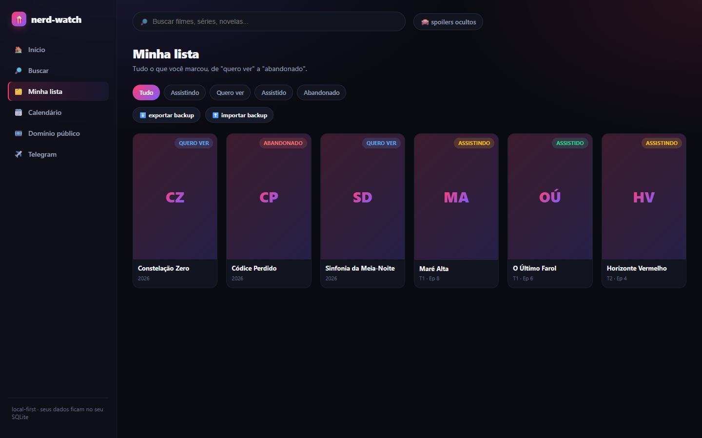
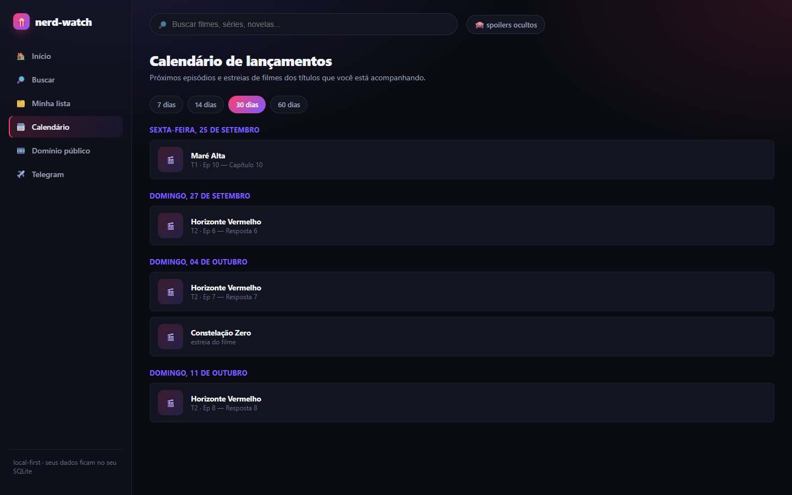
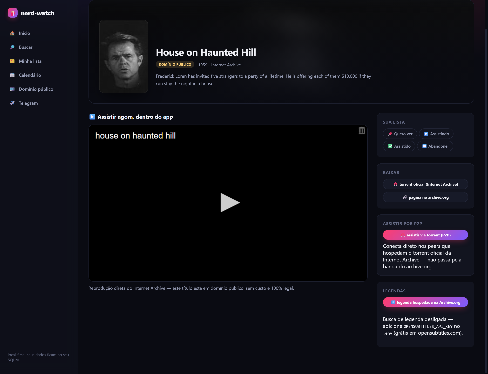
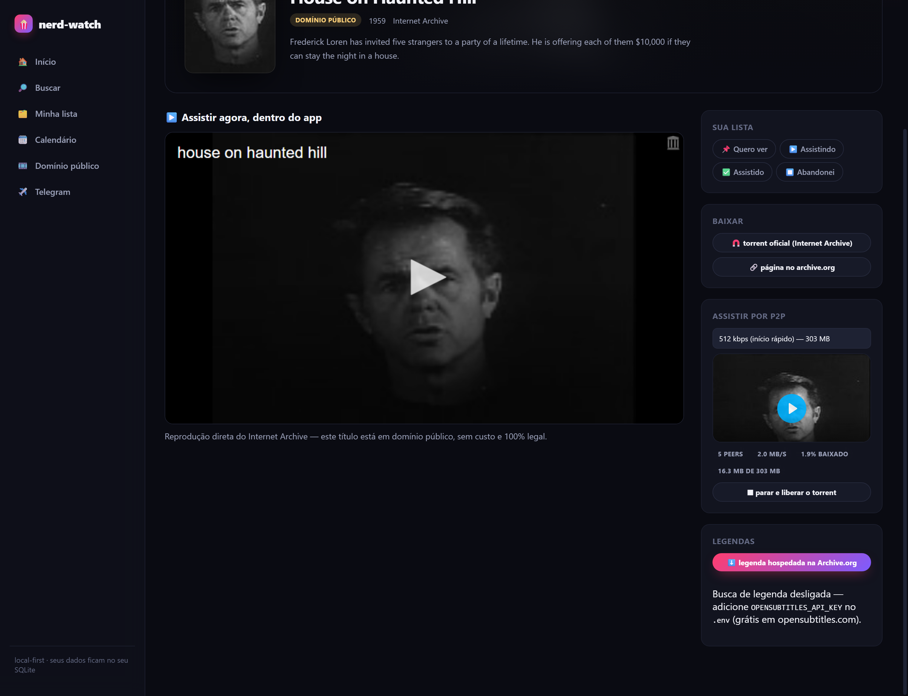

<div align="center">

# 🍿 nerd-watch

**Controle o que você assistiu, está assistindo e quer assistir — filmes, séries e novelas, em streaming ou não.**

App local que junta catálogo (TMDB), domínio público de graça (Internet Archive, com player embutido
e torrent legal), calendário de lançamentos e progresso "onde parei", com spoilers sob demanda.


</div>

---

## ✨ O que ele faz

| | |
|---|---|
| 🗂️ **Biblioteca** | quero ver / assistindo / assistido / abandonado, nota de 0 a 10, notas livres; abas com contagem, filtro por origem, grade ou lista e ações em lote |
| 🔖 **Onde você parou** | temporada e episódio atual por série, marcado com um clique |
| ⏭️ **Próximos episódios** | no início, o próximo episódio não visto de cada série em andamento, pela última atividade (carrega até 12; posição de vídeo de canal segue em "Continuar assistindo") |
| 🕘 **Histórico e revisão** | cada mudança de status e de progresso fica registrada (lista recolhível na página do título, no backup também); **Rever** volta um título assistido para "assistindo" e conta as revisões ("Visto N vezes") |
| 🗓️ **Agenda** | próximos episódios e estreias de filme dos títulos que você acompanha, com faixa de 7 dias |
| 📊 **Estatísticas** | `/estatisticas` (atalho `g e`): conclusões, tempo assistido estimado, gêneros, notas, dia da semana e maior sequência de dias por ano, mais a fila "quero ver" com data de término no ritmo escolhido. Tempo usa a duração do catálogo (TMDB, TVmaze, AniList); o que não tem duração fica de fora e é contado. Datas seguem o fuso do navegador. **Compartilhar ano** gera um PNG no próprio navegador, só com totais. API: `GET /api/stats?year=&tz=&hpd=` |
| 🔔 **Avisos de lançamento** | um aviso por lançamento da sua lista, por webhook ou [ntfy](docs/providers/notifications.md) (configurado no `.env`, desligado por padrão); antecedência de 0 a 7 dias |
| 📅 **Assinar a agenda** | feed `.ics` em `/api/calendar.ics` (`?days=`, padrão 60, máx. 365) com os mesmos lançamentos; cada evento tem UID estável, então reassinar não duplica. Botão **Assinar no calendário** copia o link. Só alcança apps que rodam na mesma máquina, porque o servidor escuta em `127.0.0.1` |
| 📊 **Estatísticas** | `/stats` (atalho `g e`): totais por status e tipo, distribuição das suas notas, concluídos por mês, mapa de calor de atividade do último ano e sequência de dias seguidos, tudo a partir do histórico local |
| ✨ **Animações** | cards entram em cascata e inclinam em 3D com brilho que segue o mouse; confete ao marcar como assistido. Tudo desliga com `prefers-reduced-motion` |
| ⌨️ **Ctrl K** | paleta de comandos (títulos, canais, ações) e atalhos `g`+letra (`?` mostra a lista) |
| 🎲 **O que assistir hoje** | sorteia um título da sua lista "quero ver" (filtro de tipo e nota mínima); "Outro" não repete o anterior. Botão na Biblioteca ou na Ctrl K |
| 📺 **Episódios** | navegação por temporada, sinopse por episódio com **spoiler oculto por padrão** |
| ✔️ **Marcar até aqui** | em um episódio, marca ele como "onde parei" e os anteriores (de todas as temporadas) ficam vistos de uma vez, com "Desfazer". O progresso é um marcador por série, então não há visto episódio a episódio |
| 🎬 **Sinopse, nota e trailer** | via TMDB (filme e série) |
| 📡 **Onde assistir** | streamings disponíveis na sua região (TMDB watch/providers) |
| 🎞️ **Domínio público** | catálogo do Internet Archive (`feature_films`) — **assiste dentro do app**, sem chave nenhuma |
| 🧲 **Torrent legal** | o torrent oficial que a própria Archive.org gera para cada item de domínio público |
| ⚡ **Streaming P2P** | toca o torrent do acervo livre dentro do app, com seek — engine em processo, sem depender da banda do archive.org |
| 💬 **Legendas sem chave** | busca em addons do protocolo do Stremio (padrão: o OpenSubtitles v3 oficial) — **não precisa de cadastro nem de chave** |
| ✈️ **Canais do Telegram** | acompanhe vídeos de canais públicos; modos bot e conta pessoal são opcionais. Login por QR code guiado em **Conexões**, feed de novidades (carrossel com os 50 vídeos mais novos) e player fixo com fila e retomada |
| 📂 **Pastas do Google Drive** | aponte uma pasta de vídeos do **seu** Drive (acesso só leitura, login OAuth em **Conexões**) e assista aqui dentro, com a mesma fila, miniaturas e "continuar assistindo" dos canais. Toca MP4/H.264 e WebM (o navegador não toca MKV/AVI) |
| 🔌 **Fontes de vídeo** | pasta local, WebDAV, S3, Dropbox, OneDrive, Jellyfin/Emby, Plex, PeerTube, YouTube (embed) e torrent: cada pasta/biblioteca vira um canal, com a mesma fila, miniaturas e "continuar assistindo". Ver [Fontes de vídeo](#-fontes-de-vídeo) |
| 📚 **Mais catálogos** | **TVmaze** (séries e datas de episódios no calendário) e **AniList** (anime), sem chave; **Trakt** importa o que você já assistiu |
| ☁️ **Progresso no servidor** | "continuar assistindo" também fica no SQLite: sobrevive a limpar o navegador e vai no backup |
| 🔒 **Local-first** | sua lista e seu progresso ficam no `data/nerd-watch.db` (SQLite); consultas ao catálogo e ao Telegram usam os serviços externos correspondentes |

Filmes e séries **protegidos por direitos autorais não são reproduzidos dentro do app** — o app te leva
até o streaming legítimo. Só o acervo de domínio público (já livre de direitos) toca localmente.

O caminho de torrent **do acervo da Internet Archive** continua restrito por construção: ele só abre
torrents derivados de um item da Archive, e os trackers/web seeds declarados dentro do `.torrent` são
conferidos — se algum apontar para fora de `*.archive.org`, o item é recusado. Sem isso, um item
publicado por terceiro faria o servidor local buscar URLs escolhidas por quem publicou.

Há também a fonte **Torrent** (em [Fontes de vídeo](#-fontes-de-vídeo)), que aceita um magnet ou um
`.torrent` que **você** cola. Ela existe por decisão explícita do dono do app: não traz busca, indexador
nem lista de sites, descarta web seeds declarados no arquivo e só mostra o aviso de que você deve
assistir apenas o que tem direito. Desligue com `TORRENT_ENABLED=false`.

---

## 📸 Telas

Capturas da app em execução com o banco fictício criado por `bun run seed`. Nenhum dado pessoal foi usado.



| Biblioteca (antes "Minha lista") | Agenda (antes "Calendário") |
|---|---|
|  |  |

Streaming P2P de um item de domínio público — `House on Haunted Hill` (1959), tocando direto do
torrent da Archive, com escolha do derivado e estatísticas de peer:

| Painel P2P | Tocando do torrent |
|---|---|
|  |  |

---

## 🚀 Rodando

```bash
bun install
cp .env.example .env      # opcional: adicione TMDB_API_KEY para o catálogo completo

bun run dev                # http://localhost:7799
```

Sem `TMDB_API_KEY` o app funciona normalmente para domínio público, sua lista e calendário — só a busca
por filmes/séries protegidos fica desligada (um aviso aparece na tela inicial). A chave é gratuita:
https://www.themoviedb.org/settings/api.

```bash
bun run seed     # popula data/nerd-watch.db com um catálogo fictício, só para ver a interface
```

### Docker

```bash
docker compose up -d --build     # http://localhost:7799
docker compose logs -f           # acompanha o boot
docker compose down              # para; os dados ficam no volume
```

- **Dados:** o SQLite e os torrents ficam no volume nomeado `nerd-watch-data` (`/app/data` dentro do
  container). `docker compose down -v` apaga tudo.
- **Segredos:** o compose lê `.env` se ele existir (`env_file` opcional), mas a imagem nunca inclui o `.env`
  (ver `.dockerignore`). Atenção: credenciais salvas pela própria UI (Telegram, Drive) são gravadas em
  `/app/.env` **dentro** do container; elas somem se o container for recriado. Para mantê-las, grave no
  `.env` do host e recrie o container com `docker compose up -d`.
- **Rede (modelo de segurança):** o container escuta em `0.0.0.0` só internamente (`HOST=0.0.0.0`), porque
  o port mapping chega pela interface do container. No host a porta é publicada como `127.0.0.1:7799`, então
  só a sua máquina alcança o app. Mesmo se você publicar em outra interface, o servidor recusa `Host` que
  não seja loopback (anti DNS rebinding) e `Origin` de outra origem em métodos que mudam estado (anti CSRF).
  Não remova o `127.0.0.1:` do `ports` sem entender isso.
- **Porta:** se o `.env` define `PORT`, ajuste o mapeamento do compose para a mesma porta.
- **Healthcheck:** a imagem checa `GET /api/health` a cada 30s; `docker compose ps` mostra `healthy`.
- **Usuário:** o processo roda como usuário `app` (não-root); só `/app/data` é gravável.
- Requer Docker Engine com Compose v2.24+ (para `env_file` com `required: false`).

### Instalar como app (PWA)

No Chrome/Edge, abra `http://localhost:7799` e use **Instalar nerd-watch** na barra de endereço. O app
abre em janela própria, sem a barra do navegador.

- O service worker (`/sw.js`) guarda **só a casca** (HTML, JS, CSS e ícones). Ele é registrado apenas em
  contexto seguro (`localhost`, ou https), que é onde o browser o aceita.
- Estratégia rede primeiro: com internet, a casca vem sempre atualizada; sem internet, a última versão
  baixada abre. O cache é `nerd-watch-shell-<versão>`, e versões antigas são apagadas no `activate`.
- **Nunca** entram no cache: `/api/*`, vídeo/áudio/legenda e qualquer requisição com `Range`. Lista, progresso,
  catálogo e reprodução continuam exigindo o servidor no ar; o offline vale só para a interface.
- Ícone: `src/client/pwa/icon.svg` (SVG, sem PNG). Alguns sistemas (iOS, por exemplo) pedem um
  `apple-touch-icon` em PNG, que ainda não existe aqui.

### Como roda

```
Hono (Bun) — server local, só escuta em 127.0.0.1
  ├─ front  → public/  (bundle Bun: catálogo, calendário, player)
  ├─ SQLite → data/nerd-watch.db (sua lista, progresso, cache de episódios)
  ├─ torrents → .cache/torrents (engine WebTorrent em processo: acervo do Archive + o que você colar em Conexões)
  └─ providers → TMDB (com chave) + Internet Archive (sem chave) + Telegram (opcional) + Google Drive (opcional)
                 + legendas via addons do protocolo Stremio (sem chave)
```

### Legendas

A busca usa o **protocolo de addons do Stremio**, que é a parte reaproveitável daquele app: o addon
publica um `/manifest.json` e responde `GET {base}/subtitles/{movie|series}/{id}.json`. Um único
adaptador, em `providers/subtitles/stremio-addon.ts`, dá acesso a várias fontes sem scraper próprio.

O padrão é o addon oficial `https://opensubtitles-v3.strem.io` e **não exige chave nem cadastro** —
a `OPENSUBTITLES_API_KEY` virou opcional e só soma como segunda fonte. Para acrescentar outra fonte,
basta apontar `SUBTITLE_ADDONS` para ela.

Duas coisas que valem saber:

- O protocolo só responde por **id do IMDb** (`idPrefixes: ["tt"]`), então a busca traduz o id da
  TMDB para o do IMDb antes de perguntar (`tmdbExternalIds`).
- O download passa por um **proxy do próprio app** (`/api/subtitles/file`). O cliente manda fonte +
  id, nunca a URL de destino: o servidor reencontra a legenda numa busca cacheada e só fala com
  hosts que estão em `SUBTITLE_ADDONS`. Sem isso o endpoint seria um proxy aberto.

Aqui não existe `stream`/`catalog` do protocolo — só `subtitles`. Puxar addon de stream traria os
indexadores de catálogo comercial, que é justamente o que o app não faz.

O servidor valida `Host` (bloqueia DNS rebinding) e `Origin` em métodos que mudam estado (bloqueia CSRF),
no mesmo padrão de segurança usado no manga-lens.

### Telegram: credenciais e login

Canais em modo **público** funcionam sem nada. Para o modo **conta pessoal** (sem o teto de 20 MB por vídeo
da Bot API) o Telegram exige um `api_id` e um `api_hash`, que **você** gera uma vez:

1. Abra https://my.telegram.org e entre com o telefone da sua conta (o Telegram manda um código para o app).
2. Clique em **API development tools** e crie um app. O formulário pede título e nome curto; os demais
   campos são opcionais. Ao salvar, a página mostra o `api_id` (número) e o `api_hash` (32 caracteres).
3. No app, abra **Conexões → Telegram**, cole os dois valores e clique em **Salvar e continuar**.
4. Clique em **Entrar com QR code**. No celular: **Ajustes → Dispositivos → Conectar dispositivo** e aponte
   para o QR. Se a conta tem verificação em duas etapas, digite a senha quando o app pedir.
5. Pronto: adicione canais em **Canais** e escolha o modo "conta pessoal". **Encerrar sessão**, em Conexões,
   desloga também no Telegram.

Sem a interface, dá para preencher `TELEGRAM_API_ID` e `TELEGRAM_API_HASH` no `.env` e rodar
`bun run telegram:login` (o login por terminal grava `TELEGRAM_SESSION` do mesmo jeito).

- Os três valores ficam só no `.env` da sua máquina e nunca voltam para o navegador. Trate o `api_hash` e a
  `TELEGRAM_SESSION` como senha: a sessão dá acesso completo à conta.
- **Gere o seu próprio `api_id`/`api_hash` e não reutilize o de outra pessoa.** O par identifica o *seu* app
  no Telegram; compartilhá-lo expõe um segredo e junta os limites de uso de todo mundo no mesmo app.
- O app guarda **uma** conta por instância. Para duas pessoas, cada uma roda a própria cópia, com `.env`,
  `PORT` e `DB_PATH` próprios; um segundo login na mesma instância substitui a sessão anterior.
- "O Telegram recusou o api_id/api_hash" na tela de login significa valor errado: confira em
  https://my.telegram.org/apps e use **Corrigir credenciais**.
- **Canais e grupos privados** (sem @usuário) só funcionam no modo **conta pessoal**, e a conta precisa
  participar deles. Em **Canais**, cole o link de qualquer mensagem (ex.: `https://t.me/c/2675951342/7`, vale
  também com tópico) ou o id, ou abra **meus canais**: a lista traz canais e supergrupos, públicos e privados.
  O app guarda o canal como `c/<id>` e mostra o nome real. Grupos antigos (os que ainda não viraram
  supergrupo) não têm esse link e ficam de fora. Links de convite (`t.me/+…`) não servem: entre no canal pelo
  Telegram primeiro.
- **Histórico e busca:** ao importar, o app traz os 100 vídeos mais recentes (na prévia pública, a página que o t.me mostra). Na página
  do canal, **carregar vídeos mais antigos** lê a próxima página do Telegram, até o começo do histórico. O
  campo de busca filtra pelo título e pela descrição dos vídeos já carregados (sem diferenciar maiúsculas nem
  acentos); **buscar “…” no Telegram** procura no canal inteiro e acrescenta os achados à lista, no lugar
  certo pela data. Vale para conta pessoal e canal público; o modo bot só recebe o que for postado dali em diante.
- O **modo bot** é opcional: crie um bot com o @BotFather, cole o token em **Conexões → Telegram → Modo bot**
  e adicione o bot como admin do canal. Ele só vê posts de depois que foi adicionado.

---

## 🌐 Expondo fora do localhost

Por padrão o nerd-watch só aceita requisições de `localhost`. Sem configurar nada, nada disso se aplica. Para
usar de outro aparelho ou de fora da sua rede, ligue o acesso por token:

1. Gere um token com pelo menos 16 caracteres (ex.: `openssl rand -base64 32`) e grave no `.env`:
   `ACCESS_TOKEN=<valor gerado>`. Um valor curto impede o app de subir, com uma mensagem clara (sem mostrar o valor).
2. Ponha um **proxy reverso com HTTPS** na frente (Caddy, nginx, Traefik ou um túnel com TLS) apontando para
   `127.0.0.1:7799`. O servidor continua escutando só em loopback. O proxy precisa repassar o `Host` original
   (nginx: `proxy_set_header Host $host;`): com outro `Host` o CSRF barra o login.
3. Só se esse proxy for o único caminho até o app, defina `ACCESS_TRUST_PROXY=true`. Ele faz o cookie sair com
   `Secure` quando o proxy informa `X-Forwarded-Proto: https`.

> ⚠️ **Use HTTPS, sem exceção.** O token viaja no formulário de login e o cookie de sessão viaja em toda
> requisição. Em HTTP puro, quem estiver no caminho (Wi-Fi público, roteador comprometido) lê os dois e assume
> sua sessão. O app não tem TLS próprio: o HTTPS é responsabilidade do proxy.

Como funciona, com `ACCESS_TOKEN` definido:

- Sem credencial, toda rota `/api/*` responde 401. A allowlist pública é só o front estático, `/login`,
  `/logout` e `GET /api/health` (que devolve apenas flags de ligado/desligado).
- No navegador, `/login` recebe o token uma vez e grava um cookie `HttpOnly; SameSite=Strict; Path=/`. O valor do
  cookie é um HMAC derivado do token, não o token. Nada vai para o `localStorage`. O `<video>` e os pedidos de
  `Range` (streaming) usam o mesmo cookie.
- Scripts mandam `Authorization: Bearer <token>`.
- Uma chamada `/api` que volta 401 no navegador leva para `/login`.
- Tentativas falhas (formulário ou Bearer) são limitadas a 10 a cada 15 minutos, por processo. Durante o bloqueio
  nenhuma credencial nova entra, mas a sessão já aberta continua valendo.
- Origin == Host continua barrando CSRF em métodos que mudam estado.
- `POST /logout` invalida a sessão no servidor. Reiniciar o processo também invalida todas as sessões, e trocar o
  `ACCESS_TOKEN` derruba quem estiver logado.

Limites conhecidos:

- Ainda não há botão "Sair" na interface; o endpoint existe, mas hoje só dá para chamá-lo por fora.
- Login OAuth de Conexões (Google Drive e fontes OAuth) usa redirect para `127.0.0.1`: não completa pelo acesso
  remoto. Conecte essas contas direto no servidor, em localhost, antes de expor.
- O cookie é `SameSite=Strict`: um link aberto a partir de outro site (e-mail, mensagem) pede o login de novo na
  primeira vez. É o preço da proteção contra CSRF.
- O limite de tentativas é global ao processo: alguém que erra a senha de propósito pode travar o login por
  15 minutos. Reiniciar o processo limpa o bloqueio.
- Não há TLS, proxy nem navegador reais exercitados nesta versão: os testes cobrem o servidor em memória
  (`tests/access-*.test.ts`). Valide o seu proxy antes de confiar nele.

## ✅ Verificação

```bash
bun run check   # lint (biome) + typecheck (tsc) + testes (bun test)
bun run smoke   # sobe o server numa porta separada e confere as rotas principais
```

Com o servidor rodando em outra aba, a PoC do streaming por torrent confere de ponta a ponta
(abertura, escolha do arquivo, `206` com `Content-Range`, seek e o recorte de segurança):

```bash
bun run poc:torrent                        # usa Sita_Sings_the_Blues (domínio público)
bun run poc:torrent -- house_on_haunted_hill_ipod
```

E a das legendas, que confere o caminho sem chave nenhuma contra o addon real:

```bash
bun run poc:subtitles                      # usa tt0111161 (filme)
bun run poc:subtitles -- tt0944947 tv      # série
```

---

## 🔌 Fontes de vídeo

Cada fonte é configurada em **Conexões** (ou no `.env`) e adicionada em **Canais**. Segredos ficam só no
`.env` (modo 0600) e nunca voltam para o navegador; a reprodução passa por um proxy no servidor.

| Fonte | Precisa de | Detalhes |
|---|---|---|
| Google Drive | OAuth (client ID/secret próprios) | [ADR](docs/adr/0001-google-drive-como-fonte.md) |
| Pasta local | `LOCAL_MEDIA_DIRS` no `.env` (somente leitura pela UI) | [docs](docs/providers/local.md) |
| WebDAV (Nextcloud, NAS) | URL, usuário e senha | [docs](docs/providers/webdav.md) |
| S3 compatível (AWS, MinIO, B2, R2) | endpoint, região, chaves | [docs](docs/providers/s3.md) |
| Dropbox | app key (OAuth PKCE, sem secret) | [docs](docs/providers/dropbox.md) |
| OneDrive pessoal | Application ID (OAuth PKCE, sem secret) | [docs](docs/providers/onedrive.md) |
| Jellyfin / Emby | URL e chave de API | [docs](docs/providers/jellyfin.md) |
| Plex | URL e token | [docs](docs/providers/plex.md) |
| PeerTube | nada | [docs](docs/providers/peertube.md) |
| YouTube (só embed) | nada | [docs](docs/providers/youtube.md) |
| Torrent (magnet / `.torrent` colado) | nada | [docs](docs/providers/torrent.md) |

Catálogos e sincronização: [TVmaze](docs/providers/tvmaze.md), [AniList](docs/providers/anilist.md),
[Trakt](docs/providers/trakt.md) e [progresso no servidor](docs/providers/progress-sync.md).

**Formatos que o navegador não toca (MKV, AVI, MOV, TS, WMV, FLV, MPEG) em pasta local:** com o ffmpeg instalado
(ou `FFMPEG_PATH`), o app copia o vídeo para MP4 quando ele já é H.264 (remux, sem perda) ou transcodifica para H.264
em tempo real quando não é (HEVC, 10 bits, MPEG-4, entrelaçado). Sem ffmpeg, esses arquivos continuam sem tocar e a
tela mostra o motivo. O selo no vídeo indica o caminho usado. Variáveis, limites e segurança em
[docs/transcoding.md](docs/transcoding.md); decisão em [ADR 0002](docs/adr/0002-conversao-com-ffmpeg.md).

> **Honestidade sobre o que foi testado:** pasta local, PeerTube, YouTube, TVmaze e AniList foram
> exercitados contra o serviço real. Google Drive, WebDAV, S3, Dropbox, OneDrive, Jellyfin, Plex e Trakt
> só contra serviços simulados e a documentação oficial — exigem conta/servidor, então o primeiro uso
> real é a validação. Cada doc lista o que não foi confirmado.
> **Torrent** tem importação por `.torrent` verificada de verdade, mas a reprodução ponta a ponta não foi
> provada: itens que dependem de *web seeds* (comum na Internet Archive) não tocam por esta fonte porque
> ela descarta web seeds de propósito — veja [a doc](docs/providers/torrent.md).

---

## 📥 Biblioteca em planilha (CSV e MyAnimeList)

Em **Conexões → Biblioteca em planilha**: baixe sua lista como CSV (abre no Excel e no Sheets) ou importe um CSV
deste formato. Dá também para importar o XML exportado do MyAnimeList.

- **Exportar:** `GET /api/library/export.csv`. Título, ano, tipo, status, nota, temporada e episódio atuais,
  notas, `tmdb_id` e data de inclusão. Células que viram fórmula na planilha recebem um apóstrofo.
- **Importar CSV:** `POST /api/library/import.csv`. Idempotente: reimportar o mesmo arquivo não duplica nada, e
  cada linha ruim vem no relatório com o número da linha. Teto de 1 MiB e 2000 linhas.
- **Importar MyAnimeList:** `POST /api/library/import.mal`. Lê o status e a nota. **Hoje o app não tem como
  casar entradas do MAL com títulos offline**, então elas aparecem no relatório como "sem correspondência" e
  nada é gravado. Não há chute.

Formato, regras de casamento, mapeamento de status e o que não foi provado: [docs/providers/importers.md](docs/providers/importers.md).

**Próximo:** um mapeamento MAL -> título (por exemplo, consulta ao AniList pelo `idMal`, online e com limite de
taxa, ou uma tabela preenchida pelo usuário) para o importador de MAL passar a gravar. Precisa de ADR antes.

---

## Limites conhecidos

- **Sem empacotamento desktop** (Tauri) nesta primeira versão — roda como app web local. Fica como
  próximo passo se fizer sentido.
- **Metadados da TMDB atualizados em background, não em tempo real.** Só entram no refresh automático os
  títulos em "Quero ver" ou "Assistindo": série em exibição a cada 24 h, série encerrada a cada 30 dias, filme só
  até lançar. Cada rodada (10 min) atualiza no máximo 5 títulos e para ao primeiro erro 429/5xx da TMDB. Sem
  `TMDB_API_KEY` o refresh não roda. O botão "Atualizar metadados" na página do título força uma atualização
  (uma a cada 60 s por título, mesmo se a tentativa falhar). A atualização busca direto na TMDB, mas a lista de
  temporadas que a página mostra ainda vem do cache em memória (até 60 min); a Agenda já usa o dado novo.
  Status, nota, anotações e progresso nunca são alterados pelo refresh.
- **Domínio público limitado à coleção `feature_films`** da Internet Archive — é a curadoria oficial
  deles para conteúdo livre; dá para ampliar depois se quiser mais fontes.
- **O torrent começa pelo derivado mais leve** (`_512kb`/`small`) para o vídeo abrir rápido, não pela
  melhor qualidade — o seletor na tela deixa você trocar para `large`/`1080p` a qualquer momento.
- **Só MP4/WebM tocam no navegador.** Itens da Archive que só têm `.ogv`/`.avi`/`.mkv` aparecem sem o
  player P2P (o download do torrent continua lá). Em **pasta local**, MKV/AVI/MOV/TS/WMV/FLV/MPEG são convertidos
  com ffmpeg, se ele estiver instalado ([docs/transcoding.md](docs/transcoding.md)).
- **O torrent baixa adiantado enquanto está aberto.** É o comportamento do engine (medido: ~50 MB em
  20s mesmo sem nenhuma leitura), e é o mesmo de qualquer cliente P2P com buffer. O consumo é
  limitado por três coisas: fechar o painel, sair da tela, e o sweeper que derruba o torrent sem
  leitura por `TORRENT_IDLE_MINUTES` (padrão 10) — aí o disco é liberado.
